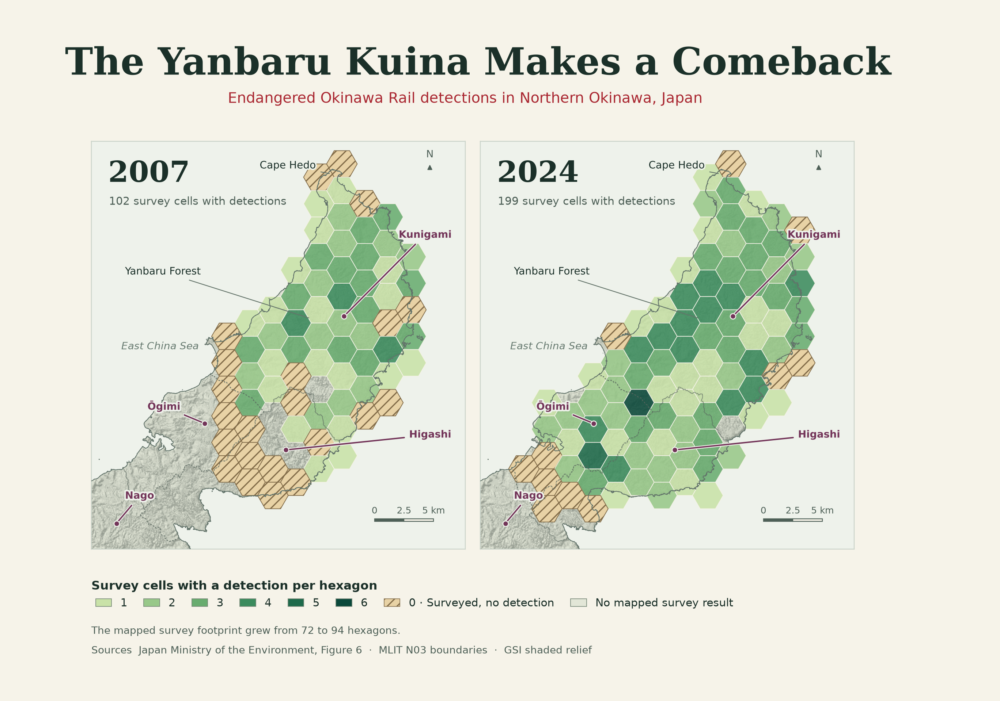

# The Yanbaru Kuina Makes a Comeback

**30 Day Map Challenge · Day 20 · Hexagons**

The Yanbaru Kuina, or Okinawa Rail, lives only in northern Okinawa Island. This map compares where surveys detected the bird in 2007 and 2024. Japan’s Ministry of the Environment reported that the rail’s range began to recover as teams controlled invasive mongooses. [Species profile](https://www.env.go.jp/nature/kisho/hogozoushoku/yambarukuina.html) · [Survey report, Figure 6](https://kyushu.env.go.jp/okinawa/press_00131.html)



## How to read the map

- **Green** shows how many survey cells in a hexagon recorded the rail. Darker green means more cells recorded it.
- **Hatched ochre** shows that surveyors looked for the rail and recorded no detection. A survey can miss birds that are present.
- **Unfilled land** has no published survey result in the source map.
- **Coastal hexagons** can extend over the sea because the grid uses whole hexagons. The fill represents survey cells grouped into that hexagon. It does not show where within the hexagon a bird was detected.

The surveys recorded the rail in **102 survey cells in 2007** and **199 in 2024**, with detections extending farther south in 2024. The mapped survey footprint also grew from **72 to 94 hexagons**. The counts refer to survey cells, and the survey figure does not give the number of individual birds.

## How the map was made

ChatGPT digitised the Ministry’s published map and created the [survey-square CSV](data/yanbaru_kuina_survey_cells.csv). The grid was aligned visually with the Okinawa coastline, so the coordinates are estimated centres of the survey squares. The mapping notebook groups those squares into hexagons. Both years use the same grid and colour scale. [Survey figure](https://kyushu.env.go.jp/okinawa/content/000377212.png)

The coastline and municipal boundaries come from Japan’s Ministry of Land, Infrastructure, Transport and Tourism. The terrain shading comes from the Geospatial Information Authority of Japan. [Okinawa boundaries](https://nlftp.mlit.go.jp/ksj/gml/data/N03/N03-2024/N03-20240101_47_GML.zip) · [Shaded relief](https://www.gsi.go.jp/bousaichiri/hillshademap.html)

ChatGPT also created the [Okinawa Rail illustration](media/okinawa_rail.png). The finished graphic was put together in GIMP.

## Run the notebooks

In your Python environment, install the packages for these two notebooks.

```sh
python -m pip install geopandas matplotlib numpy pillow pyproj shapely ipykernel
```

In VS Code, open the notebook and select that environment as the Python kernel. Run the cells with `day20_hexagons/` as the notebook’s working directory and internet access for the source downloads.

1. [Create the survey dataset](01_create_survey_dataset.ipynb). Run this notebook to download Figure 6 and recreate the [CSV](data/yanbaru_kuina_survey_cells.csv).
2. [Build the hexagon map](02_map_hexagons.ipynb). Start here if you want to use the included CSV and make your own map. The notebook walks through the grid, counts, colour scale, legend and title. The last cell writes the notebook version to `media/yanbaru_kuina_hexagons.png`, the same path as the finished PNG.

## File Structure

```text
day20_hexagons/
├── README.md
├── 01_create_survey_dataset.ipynb
├── 02_map_hexagons.ipynb
├── data/
│   └── yanbaru_kuina_survey_cells.csv
└── media/
    ├── okinawa_rail.png
    ├── yanbaru_kuina_hexagons.jpg
    └── yanbaru_kuina_hexagons.png
```
